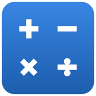
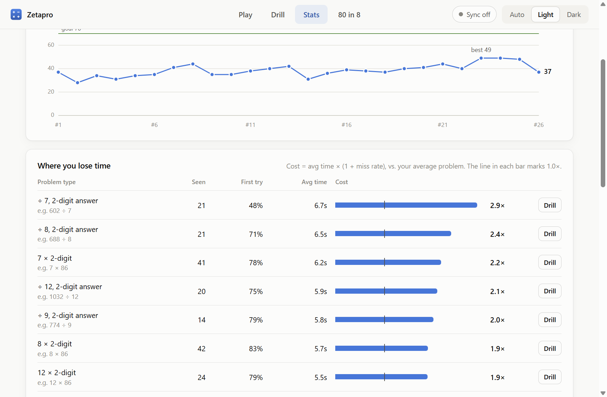
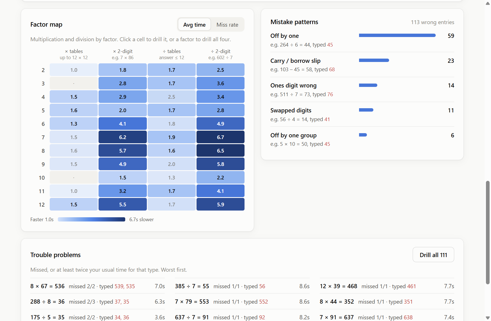
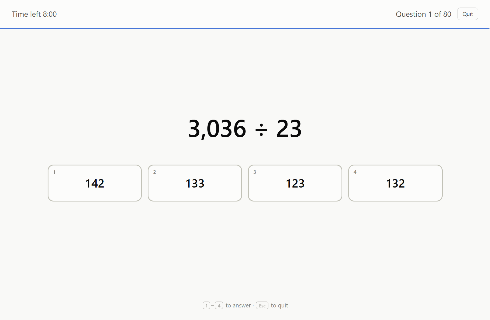

  

<h1 align="center">Zetapro</h1>

  <b>Get faster at mental maths, and see exactly what's slowing you down.</b> 
  A Zetamac-style speed game and an Optiver-style “80 in 8”, with per-problem-type stats and targeted drills.

  <a href="https://amirkhan0725.github.io/zetapro/"><b>Play in your browser</b></a> ·
  <a href="https://github.com/amirkhan0725/zetapro/releases/latest">Download for Windows</a> ·
  <a href="https://github.com/amirkhan0725/zetapro/issues">Report a bug</a>

  

## Why

Zetamac is a great way to build arithmetic speed, but a round ends with a single number. Zetapro times every answer, sorts it by problem type (carries, borrows, each times table, 2-digit products, decimal division, fractions…) and shows which types cost you the most time and which mistakes you repeat. It then turns those weak spots into targeted drills, so practice goes where it helps most.

## Features

- **Classic Zetamac:** same rules and defaults (2 minutes; an answer counts the instant it's right).
- **Where you lose time:** every problem type ranked by how much it slows you down, plus a factor map for × and ÷, mistake patterns (carry slips, off-by-one, swapped digits…) and the exact problems you keep missing.
- **Drills:** smart drills built from your slowest types, trouble-problem drills that retire problems once you've mastered them, or pick your own, with pace tracked per minute.
- **80 in 8:** 80 multiple-choice questions in 8 minutes (whole numbers, decimals, fractions, missing numbers) with net scoring and per-type stats.
- **Goals:** set a target score and track how consistently you hit it.
- **Sign in and sync (optional):** sign in with Google or email to keep phone, tablet and computer in step.
- **Phone-friendly:** installs to your home screen, has its own number pad, and works offline.
- **Your data, your control:** undo deletes, restore earlier synced versions, export or import a backup file.

  
  

## Get it

| Where | How |
| --- | --- |
| **Any browser** | Open [amirkhan0725.github.io/zetapro](https://amirkhan0725.github.io/zetapro/). Nothing to install. |
| **iPhone** | Open the link in Safari → Share → *Add to Home Screen*. |
| **Android** | Open the link in Chrome → ⋮ → *Install app*. |
| **Windows** | [Download the zip](https://github.com/amirkhan0725/zetapro/releases/latest), unzip, run `Zetapro.exe`. It isn't code-signed, so Windows may ask: *More info → Run anyway*. |

## Privacy

No ads, no analytics, no tracking. Games are saved on your device. If you sign in, they also sync to your own account, and database rules let only you read or write it. Signing in is optional; everything works without an account.

## About this repository

This repository holds the **built website and app** that GitHub Pages serves at the link above, plus the Windows downloads under [Releases](https://github.com/amirkhan0725/zetapro/releases). It's published automatically and replaced on each release, so pull requests against these files won't be merged. To suggest something, [open an issue](https://github.com/amirkhan0725/zetapro/issues).

Built with plain JavaScript (no framework), Electron for the Windows app, and Firebase for optional sign-in and sync.

Zetapro is an independent practice tool, not affiliated with Zetamac or Optiver.
